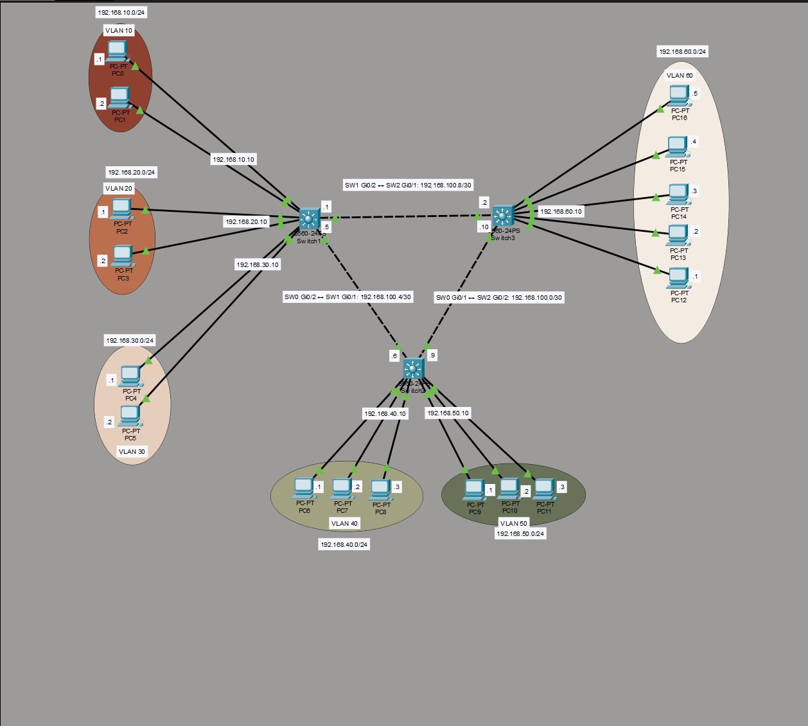

# Lab 09 — OSPF Across Three Layer 3 Switches (Distributed Inter-VLAN Routing)

**Date:** August 23–24, 2026
**Platform:** Cisco Packet Tracer 8.x — 3x Catalyst 3560-24PS multilayer switches, 17 PCs
**Time spent:** ~3 hrs
**Status:** Complete — six VLANs, full any-to-any reachability, ECMP confirmed on the backbone

---

## Objective

Replace the single-router inter-VLAN model from Lab 08 with **three Layer 3 switches**, each owning its own VLANs and routing locally, connected by a triangle of routed point-to-point links running **OSPF single-area**.

This is the combination of the two previous labs: Lab 08's VLAN segmentation, Lab 07's dynamic routing — but with the routing function moved *onto* the switches instead of a separate router, and no trunks anywhere.

Success criteria:

1. Each switch routes between its own VLANs locally (SVIs + `ip routing`).
2. The three switches form OSPF adjacencies over routed ports and learn every remote VLAN.
3. Any PC can reach any other PC across all six VLANs, with zero static routes.

---

## Topology

Three multilayer switches in a triangle. Every VLAN is local to exactly one switch; every inter-switch link is a routed `/30`.

```
                 VLAN 10, 20, 30
                       │
                    [ SW1 ]
              .1  Gi0/1   Gi0/2  .5
                 /             \
    192.168.100.0/30       192.168.100.4/30
               /                 \
          .2 Gi0/2            .6 Gi0/1
        [ SW3 ]────────────────[ SW2 ]
     Gi0/1 .10   192.168.100.8/30   .9 Gi0/2
          │                          │
       VLAN 60                  VLAN 40, 50
```

**Device naming — read this before comparing to the topology image.** The Packet Tracer labels and the configured hostnames do not line up in the obvious order:

| Hostname (config) | Diagram label | VLANs owned | Router ID |
|---|---|---|---|
| **SW1** | Multilayer Switch0 (upper left) | 10, 20, 30 | 1.1.1.1 |
| **SW2** | Multilayer Switch1 (bottom) | 40, 50 | 2.2.2.2 |
| **SW3** | Multilayer Switch2 (right) | 60 | 3.3.3.3 |

This README uses the hostnames throughout. *(Fix in the .pkt: rename the devices so the diagram matches.)*



---

## Addressing

### VLANs and gateways

Each VLAN is a flat `/24`. The gateway is the SVI on the owning switch, always at **.10**.

| VLAN | Name | Subnet | Gateway (SVI) | Owner | Hosts |
|------|------|--------|---------------|-------|-------|
| 10 | Engineering | 192.168.10.0/24 | 192.168.10.10 | SW1 | PC0–PC1 (.1–.2) |
| 20 | HR | 192.168.20.0/24 | 192.168.20.10 | SW1 | PC2–PC3 (.1–.2) |
| 30 | Sales | 192.168.30.0/24 | 192.168.30.10 | SW1 | PC4–PC5 (.1–.2) |
| 40 | Marketing | 192.168.40.0/24 | 192.168.40.10 | SW2 | PC6–PC8 (.1–.3) |
| 50 | Finance | 192.168.50.0/24 | 192.168.50.10 | SW2 | PC9–PC11 (.1–.3) |
| 60 | IT/Operations | 192.168.60.0/24 | 192.168.60.10 | SW3 | PC12–PC16 (.1–.5) |

All hosts: mask 255.255.255.0, interface Fa0.

**Why .10 and not .1 or .254:** arbitrary but consistent. The value of a convention is that it's the same everywhere — any host in any VLAN can guess its gateway. Lab 08 used *last usable*, which was a subnetting exercise; here the `/24`s are flat so a fixed low number is simpler to remember.

### Backbone — routed /30 links

The three inter-switch links are carved out of 192.168.100.0/24, one `/30` each. A `/30` gives exactly two usable addresses, which is exactly what a point-to-point link needs.

| Link | Subnet | End A | End B |
|------|--------|-------|-------|
| A | 192.168.100.0/30 | SW1 Gi0/1 — .1 | SW3 Gi0/2 — .2 |
| B | 192.168.100.4/30 | SW1 Gi0/2 — .5 | SW2 Gi0/1 — .6 |
| C | 192.168.100.8/30 | SW2 Gi0/2 — .9 | SW3 Gi0/1 — .10 |

**Note the port ordering isn't uniform.** On SW1, Gi0/1 faces SW3 and Gi0/2 faces SW2; on SW3 it's the reverse. That's fine — OSPF doesn't care — but it makes reading `show ip route` output slower than it needs to be. A cleaner design would fix a convention (e.g. Gi0/1 always faces the lower-numbered neighbor).

---

## Configuration

The same five-step pattern on every switch. Full transcripts in `configs/`.

### Step 1 — create and name the VLANs

```
vlan 10
 name Engineering
vlan 20
 name HR
vlan 30
 name Sales
```

Naming happens in `vlan <id>` config mode — **not** interface mode, and not with `ip address` (see troubleshooting #3).

### Step 2 — assign access ports

Ports facing hosts are access ports carrying one untagged VLAN:

```
interface range fastEthernet 0/1-2
 switchport mode access
 switchport access vlan 10
interface range fastEthernet 0/3-4
 switchport mode access
 switchport access vlan 20
interface range fastEthernet 0/5-6
 switchport mode access
 switchport access vlan 30
```

`show vlan brief` confirms port-to-VLAN placement.

### Step 3 — SVIs (the VLAN gateways)

An SVI is a virtual L3 interface representing the whole VLAN. Its address is what hosts in that VLAN use as their default gateway:

```
interface vlan 10
 ip address 192.168.10.10 255.255.255.0
 no shutdown
interface vlan 20
 ip address 192.168.20.10 255.255.255.0
 no shutdown
interface vlan 30
 ip address 192.168.30.10 255.255.255.0
 no shutdown
```

An SVI only comes up when the VLAN exists *and* at least one access port in it is up — which is why `%LINEPROTO-5-UPDOWN: Line protocol on Interface Vlan10, changed state to up` appears the moment the first access port is assigned, before the SVI was even addressed.

### Step 4 — enable routing

```
ip routing
```

One line, and nothing works without it. A multilayer switch with perfect SVIs and perfect IP addresses is still just a switch until `ip routing` is on — the SVIs will answer pings addressed to themselves but won't forward a packet from one VLAN to another.

### Step 5 — routed ports and OSPF

The uplinks must stop being switchports before they can hold an IP:

```
interface gigabitEthernet 0/1
 no switchport
 ip address 192.168.100.1 255.255.255.252
 no shutdown
interface gigabitEthernet 0/2
 no switchport
 ip address 192.168.100.5 255.255.255.252
 no shutdown
```

`no switchport` converts an L2 port into a **routed port** — no VLAN membership, no STP participation for a VLAN, behaves like a router interface. The line protocol bounces down and back up as the port changes mode, which is expected.

Then OSPF (SW1 shown; SW2 and SW3 identical in shape):

```
router ospf 10
 router-id 1.1.1.1
 network 192.168.10.0 0.0.0.255 area 0
 network 192.168.20.0 0.0.0.255 area 0
 network 192.168.30.0 0.0.0.255 area 0
 network 192.168.100.0 0.0.0.3 area 0
 network 192.168.100.4 0.0.0.3 area 0
 passive-interface vlan 10
 passive-interface vlan 20
 passive-interface vlan 30
```

- **Process ID `10`** is locally significant — it does not need to match between devices and never appears in an OSPF packet. It's kept consistent here for readability only.
- **Router IDs are set manually** (1.1.1.1 / 2.2.2.2 / 3.3.3.3). Auto-selection *does* exist (highest loopback IP, else highest up interface IP at process start), but it's sticky and unpredictable — adding a loopback later can silently change the RID and force every LSA that device originated to be re-announced. Manual RID removes the variable.
- **`passive-interface` on every SVI** stops hello packets from being sent toward end hosts. The VLAN subnet is still advertised; OSPF just stops trying to find neighbors on a segment where only PCs live. This is the correct default posture for any host-facing interface.
- **`0.0.0.3` is the wildcard for a /30** — the inverse of 255.255.255.252.

### Persist

```
end
copy running-config startup-config
```

Done on all three. The reflex is now automatic.

---

## Verification

### 1. Adjacencies — two neighbors per switch

Each switch sits on two links, so each should have exactly two FULL neighbors. SW1:

```
Neighbor ID     Pri   State        Dead Time   Address          Interface
2.2.2.2           1   FULL/BDR     00:00:38    192.168.100.6    GigabitEthernet0/2
3.3.3.3           1   FULL/BDR     00:00:33    192.168.100.2    GigabitEthernet0/1
```

Two neighbors × three switches = the triangle is fully formed. The manually-set router IDs make this output immediately readable — `2.2.2.2` is unmistakably SW2, where an auto-selected `192.168.100.9` would have required a lookup.

### 2. Routing tables — every remote VLAN learned

SW3's table, having learned all five VLANs it doesn't own:

```
O    192.168.10.0 [110/2] via 192.168.100.1, GigabitEthernet0/2
O    192.168.20.0 [110/2] via 192.168.100.1, GigabitEthernet0/2
O    192.168.30.0 [110/2] via 192.168.100.1, GigabitEthernet0/2
O    192.168.40.0 [110/2] via 192.168.100.9, GigabitEthernet0/1
O    192.168.50.0 [110/2] via 192.168.100.9, GigabitEthernet0/1
     192.168.100.0/30 is subnetted, 3 subnets
O       192.168.100.4 [110/2] via 192.168.100.1, GigabitEthernet0/2
                      [110/2] via 192.168.100.9, GigabitEthernet0/1
```

Every entry is `O` — dynamically learned, zero static routes in the whole lab.

### 3. Equal-cost load balancing on the far link

The last entry above is the interesting one: **two paths installed for 192.168.100.4/30**. From SW3, the link between SW1 and SW2 is reachable clockwise or counter-clockwise around the triangle, both at cost 2, so OSPF installs both and load-balances. Each switch shows this for the one `/30` it isn't attached to.

**Why every cost is 2.** OSPF cost = reference bandwidth ÷ interface bandwidth, and the default reference is 100 Mbps. A Gigabit link computes to 0.1, which rounds up to the minimum of 1; a FastEthernet SVI is exactly 1. So one transit link + one destination segment = 2, and **OSPF currently cannot tell a Gigabit link from a FastEthernet one**. That's a real limitation, not a quirk of this topology (see next steps).

### 4. End-to-end reachability — read the TTL

Windows hosts send with TTL 128; each L3 hop decrements by one. That makes TTL a direct count of how many switches routed the packet:

| Test | Result | TTL | Hops | Meaning |
|------|--------|-----|------|---------|
| PC11 (V50) → 192.168.50.2 (V50) | 4/4 | **128** | 0 | Same VLAN — switched, never routed |
| PC11 (V50) → 192.168.40.2 (V40) | 4/4 | **127** | 1 | Both VLANs on SW2 — routed locally, backbone untouched |
| PC11 (V50) → 192.168.30.2 (V30) | 4/4 | **126** | 2 | SW2 → SW1, crossed the backbone |
| PC16 (V60) → 192.168.60.1 (V60) | 4/4 | **128** | 0 | Same VLAN |
| PC16 (V60) → 192.168.10.1 (V10) | 3/4 | **126** | 2 | SW3 → SW1 |
| PC0 (V10) → 192.168.20.2 (V20) | 3/4 | **127** | 1 | Both on SW1 |
| PC0 (V10) → 192.168.40.2 (V40) | 4/4 | **126** | 2 | SW1 → SW2 |

**The three TTL values are the whole architecture in one number.** 128 means the traffic never left Layer 2. 127 means one multilayer switch routed it — the distributed-routing win, since that traffic never touched the backbone at all. 126 means it crossed one inter-switch link. There is no 125 anywhere in the captures, which confirms nothing is taking a long way around the triangle.

The 3/4 results are first-packet ARP resolution, not loss (see troubleshooting #6).

---

## Troubleshooting log

| # | Symptom | Cause | Fix |
|---|---------|-------|-----|
| 1 | PC0 → 192.168.40.2: `Reply from 192.168.10.10: Destination host unreachable` ×4, 100% loss | **SW1 itself answered.** The gateway had no route to 192.168.40.0/24 — the OSPF adjacency toward SW2 hadn't reached FULL yet | None needed; retested after convergence → 4/4 at TTL 126. See note below |
| 2 | Same test, transitional: 2× unreachable, 1× timeout, 1× **success** in a single 4-packet run | Caught OSPF converging mid-ping — the route was installed partway through the series | Confirms #1's diagnosis; the fix was time, not config |
| 3 | `SW2(config-vlan)#ip address 192.168.40.10 ...` → `% Invalid input at '^'` | Tried to address a VLAN from **VLAN config mode**. `vlan 40` defines the VLAN; it isn't the gateway interface | `interface vlan 40`, *then* `ip address` |
| 4 | `switchport access vlan` → `% Incomplete command` | VLAN ID omitted | Supply the ID: `switchport access vlan 50` |
| 5 | `show ip int brief` inside config mode → `% Invalid input at '^'` | EXEC command in config mode | Prefix with `do` |
| 6 | First packet of most ping series times out (3/4 = 25% "loss") | ARP resolution on packet 1 — the host doesn't yet have the gateway's MAC | Benign. Packets 2–4 always succeed. Distinguishing this from real loss is the skill |
| 7 | `Switch#config` → `Configuring from terminal, memory, or network [terminal]?` | Bare `config` prompts for a source | `config t` |
| 8 | `SW3>rn` → `Translating "rn"...domain server (255.255.255.255) % Name lookup aborted` | Typo for `en`; IOS treated an unknown word as a hostname to resolve | Type `enable`. (Worth knowing: `no ip domain-lookup` stops these hangs) |

**Entry #1 is the one worth internalizing.** `Destination host unreachable` sent *by your own default gateway* is a fundamentally different signal from `Request timed out`:

- **Timeout** = silence. The packet left and nothing came back. Could be anywhere along the path — forward, return, or the destination itself.
- **Unreachable from the gateway** = your first-hop router is talking to you, and what it's saying is *"I looked in my routing table and there's no entry for that destination."* The problem is provably local, one hop away, in the control plane — not cabling, not the far end, not the return path.

That narrows the search from "the whole network" to "why doesn't SW1 have this route," which in this case answered itself sixty seconds later when OSPF finished converging. It's the same lesson as Lab 06's `U` vs `.` distinction, arriving in a new form: *read what the output is actually telling you, not just whether it succeeded.*

---

## Key takeaways

**A multilayer switch is a router that happens to have a lot of ports.** `ip routing` + SVIs + `no switchport` uplinks, and it behaves like any router running OSPF. Nothing in the OSPF configuration here would look different on an ISR — the wildcard masks, area, router-id, and passive-interface logic all transfer directly. The only switch-specific parts are `ip routing` (a router has it on by default) and `no switchport` (a router's ports are already routed).

**Distributed routing beats router-on-a-stick, and TTL proves it.** In Lab 08 every cross-VLAN packet had to travel to the single router and back over one trunk. Here, VLAN 40 → VLAN 50 traffic never leaves SW2 — TTL 127, one hop, backbone untouched. Only genuinely inter-switch traffic uses the uplinks. The bottleneck Lab 08's "open questions" flagged is gone by construction.

**No trunks. That's the design, not an omission.** Every VLAN lives entirely on one switch, so nothing needs to carry tagged frames between switches — the inter-switch links are routed `/30`s instead. This eliminates the entire class of failure from Lab 08 (a VLAN missing on one end of a trunk silently blackholing traffic) and shrinks each VLAN's broadcast domain to a single switch. The trade-off: a VLAN can't span switches. If Marketing needed a host on SW1, this design would have to change.

**`no switchport` is the hinge between L2 and L3.** An L2 port can hold VLAN membership but not an IP; a routed port holds an IP but no VLAN. SVIs are the third case — L3 from birth, representing a VLAN rather than a port, so they never need `no switchport`. Knowing which of the three you're configuring resolves most "why won't this take an IP address" confusion on a multilayer switch.

**Manual router IDs pay for themselves the first time you read `show ip ospf neighbor`.** `2.2.2.2` identifies SW2 instantly. An auto-selected `192.168.100.9` would identify a *link*, and you'd have to work backward to the device. The operational readability is worth more than the two lines of config, before even counting the stability argument.

**Default OSPF cost can't see the difference between Gigabit and FastEthernet.** Every route in this lab is `[110/2]` because the 100 Mbps default reference bandwidth floors any link faster than FastEthernet at cost 1. In a lab with uniform links it's harmless. In a real network with mixed speeds, OSPF would happily prefer a 100 Mbps path over a 10 Gbps one. `auto-cost reference-bandwidth` exists for exactly this.

**Convergence is a state, not an event.** Entries #1 and #2 caught the network mid-transition — the same ping command failing, then partially working, then fully working, with no configuration change in between. Dynamic routing means "correct eventually," and knowing to check `show ip ospf neighbor` for FULL before trusting a failed ping saves a lot of chasing.

---

## Open questions / next steps

- **Cut a backbone link and time the failover.** The triangle means any single link can fail and every VLAN stays reachable — but that's asserted here, not demonstrated. Shut one Gi port, run a continuous ping, count the dropped packets during reconvergence. This is the highest-value missing test in the lab.
- **`auto-cost reference-bandwidth 1000`** on all three, then confirm Gigabit links drop to cost 1 and FastEthernet SVIs rise to 10 — making the metric actually reflect speed. Must be set identically on every device or path selection goes inconsistent.
- **Summarize the backbone statements.** All three `/30`s sit inside 192.168.100.0/24, so `network 192.168.100.0 0.0.0.255 area 0` replaces two lines per switch. Same aggregation idea as Lab 06's `/16` static summary and Lab 07's wildcard collapse — third appearance of one concept in three contexts.
- **Interface-level OSPF** (`ip ospf 10 area 0` under each interface) instead of `network` statements, to compare. More explicit, no wildcard arithmetic, and the form that templates cleanly for automation.
- **DHCP per VLAN** via `ip helper-address` pointing at a central server, replacing 17 static host assignments.
- **Automate the build.** Six VLANs × three switches with a repeating five-step pattern is exactly the shape that suits Netmiko — generate each switch's config from a structured definition of VLANs, SVIs, links, and router IDs rather than typing it. Natural bridge to the Python automation project.
- **Harden the access layer:** `switchport port-security`, shut unused ports, and confirm VLAN 1 is unused everywhere (it currently is, by accident rather than by policy).

---

## Files

- `topology.png` — three-switch triangle with VLAN and backbone addressing
- `configs/` — full `show running-config` and build transcripts for SW1, SW2, SW3
- `verification/` — `show ip ospf neighbor`, `show ip route ospf`, and per-host ping captures (PC0, PC11, PC16)
- `Big Project OSPF and VLAN.pdf` — original working document
- `lab.pkt` — Packet Tracer source