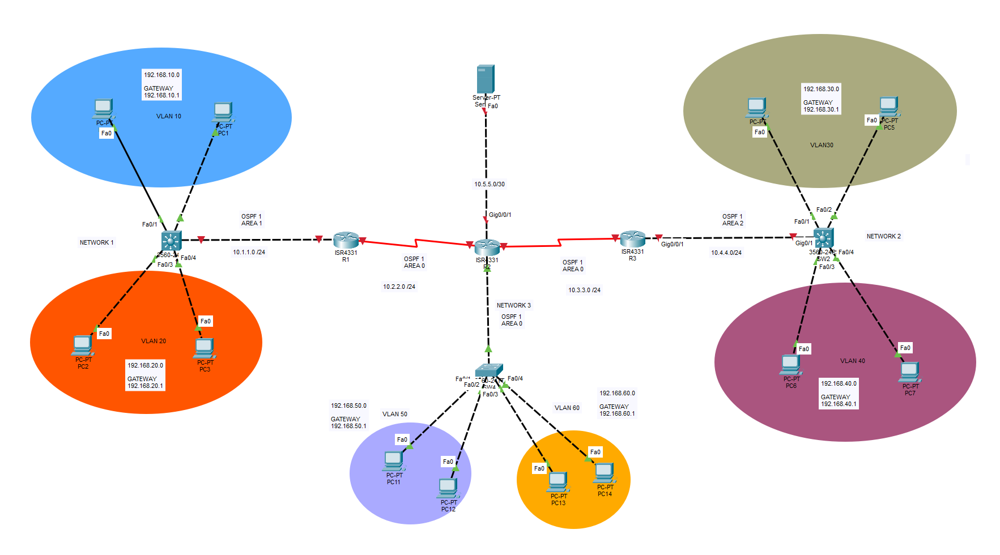

# Lab 10 — Multi-Area OSPF, Inter-VLAN Routing and DHCP Relay

**Date:** September – November 2026
**Platform:** Cisco Packet Tracer 8.x — 3x ISR4331 routers, 2x Catalyst 3560-24PS multilayer switches, 1x Catalyst 2960 access switch, 1x DHCP server, 14 PCs
**Status:** Complete — six VLANs across three OSPF areas, every PC addressed by one central DHCP server, full any-to-any reachability
**Video walkthrough:** 3-part series on [Tech with Obinna](https://www.youtube.com/@TechwithObinna) — [Part 1: VLANs](#) · [Part 2: Multi-Area OSPF](#) · [Part 3: DHCP Relay](#)

---

## Objective

Combine everything from Labs 07–09 into one network, then add the two pieces those labs left as "next steps": **multi-area OSPF** and **centralized DHCP**.

- Two kinds of inter-VLAN routing in the same network: **Layer 3 switches with SVIs** at the two edge sites, **router-on-a-stick** at the core site.
- **OSPF across three areas**, with R1 and R3 as area border routers (ABRs) joining areas 1 and 2 to the backbone.
- **One DHCP server** in the middle of the network handing out addresses to all six VLANs, using DHCP relay (`ip helper-address`).

Success criteria:

1. Every VLAN can reach every other VLAN, with zero static routes.
2. Routes from other areas show up as `O IA` (inter-area); routes inside the same area show up as `O`.
3. Every PC gets its IP, mask, gateway and DNS from the central server — no static host addressing.

---

## Topology

```
         Area 1                     Area 0 (backbone)                    Area 2
  ┌──────────────────┐   ┌───────────────────────────────────┐   ┌──────────────────┐
  VLAN 10 ─┐                           Server0                                ┌─ VLAN 30
           [SW1]─────[R1]════S0/2/0════[R2]════S0/2/1════[R3]─────[SW2]
  VLAN 20 ─┘ 10.1.1.0/24  10.2.2.0/24   │   10.3.3.0/24   10.4.4.0/24       └─ VLAN 40
                                        │ trunk (802.1Q)
                                      [SW4]  (Layer 2 only)
                                      /    \
                                 VLAN 50   VLAN 60
```



| Device | Model | Role | OSPF areas |
|---|---|---|---|
| **R1** | ISR4331 | ABR | 0, 1 |
| **R2** | ISR4331 | Backbone core, router-on-a-stick for VLAN 50/60, gateway to the server | 0 |
| **R3** | ISR4331 | ABR | 0, 2 |
| **SW1** | 3560-24PS | Layer 3 switch, gateway for VLAN 10/20 | 1 |
| **SW2** | 3560-24PS | Layer 3 switch, gateway for VLAN 30/40 | 2 |
| **SW4** | 2960-24TT | Layer 2 access switch for VLAN 50/60, trunk to R2 | — |
| **Server0** | Server-PT | Central DHCP server | — |

---

## Addressing

### VLANs and gateways

Every VLAN is a flat `/24` with its gateway at **.1**. DHCP hands out addresses starting at **.10**, leaving .2–.9 free for anything that needs a fixed address.

| VLAN | Subnet | Gateway | Gateway lives on | DHCP range starts |
|---|---|---|---|---|
| 10 | 192.168.10.0/24 | 192.168.10.1 | SW1 — SVI `Vlan10` | .10 |
| 20 | 192.168.20.0/24 | 192.168.20.1 | SW1 — SVI `Vlan20` | .10 |
| 30 | 192.168.30.0/24 | 192.168.30.1 | SW2 — SVI `Vlan30` | .10 |
| 40 | 192.168.40.0/24 | 192.168.40.1 | SW2 — SVI `Vlan40` | .10 |
| 50 | 192.168.50.0/24 | 192.168.50.1 | R2 — subinterface `Gi0/0/0.50` | .10 |
| 60 | 192.168.60.0/24 | 192.168.60.1 | R2 — subinterface `Gi0/0/0.60` | .10 |

### Point-to-point links

| Link | Subnet | End A | End B | Area |
|---|---|---|---|---|
| SW1 ↔ R1 | 10.1.1.0/24 | SW1 Gi0/1 — .1 | R1 Gi0/0/1 — .2 | 1 |
| R1 ↔ R2 | 10.2.2.0/24 | R1 S0/2/0 — .1 | R2 S0/2/0 — .2 | 0 |
| R2 ↔ R3 | 10.3.3.0/24 | R2 S0/2/1 — .1 | R3 S0/2/1 — .2 | 0 |
| R3 ↔ SW2 | 10.4.4.0/24 | R3 Gi0/0/1 — .1 | SW2 Gi0/1 — .2 | 2 |
| R2 ↔ Server0 | 10.5.5.0/30 | R2 Gi0/0/1 — .1 | Server0 Fa0 — .2 | 0 |

The router-to-router links use `/24`s for readability. A `/30` is the right size for a point-to-point link (two usable addresses), and the server link uses one — see open questions about applying it everywhere.

---

## Configuration

Full transcripts per device are in `configs/`. The shapes below are the parts worth explaining.

### 1. VLANs and inter-VLAN routing

**Edge sites (SW1, SW2) — Layer 3 switch.** Same pattern as Lab 09: VLANs, access ports, an SVI per VLAN as the gateway, `ip routing`, and the uplink converted to a routed port.

```
ip routing
!
interface vlan 10
 ip address 192.168.10.1 255.255.255.0
interface vlan 20
 ip address 192.168.20.1 255.255.255.0
!
interface gigabitEthernet 0/1
 no switchport                          ! L2 port → routed port so it can hold an IP
 ip address 10.1.1.1 255.255.255.0
```

**Core site (R2 + SW4) — router-on-a-stick.** SW4 is a Layer 2 switch: access ports for VLAN 50/60 and one trunk to R2. R2 routes between them on subinterfaces.

```
! SW4
interface gigabitEthernet 0/1
 switchport mode trunk
 switchport trunk allowed vlan 50,60
!
! R2
interface gigabitEthernet 0/0/0.50
 encapsulation dot1Q 50                 ! this line decides the VLAN, not the ".50"
 ip address 192.168.50.1 255.255.255.0
interface gigabitEthernet 0/0/0.60
 encapsulation dot1Q 60
 ip address 192.168.60.1 255.255.255.0
```

**SW4 holds no gateway IPs.** A Layer 2 switch only needs an SVI for management, and that SVI must never reuse the gateway address — see troubleshooting #1.

### 2. Multi-area OSPF

The rule that matters: **an area belongs to a link, and both ends of a link must agree on it.** R1 and R3 are ABRs because they have interfaces in two areas.

```
! R2 — everything in the backbone
router ospf 1
 network 10.2.2.0 0.0.0.255 area 0
 network 10.3.3.0 0.0.0.255 area 0
 network 192.168.50.0 0.0.0.255 area 0
 network 192.168.60.0 0.0.0.255 area 0
 network 10.5.5.0 0.0.0.3 area 0         ! /30 → wildcard 0.0.0.3
 passive-interface gigabitEthernet 0/0/0.50
 passive-interface gigabitEthernet 0/0/0.60
!
! R1 — ABR between area 0 and area 1
router ospf 1
 network 10.2.2.0 0.0.0.255 area 0       ! toward R2
 network 10.1.1.0 0.0.0.255 area 1       ! toward SW1 — must match SW1's area
!
! SW1 — all of area 1
router ospf 1
 network 10.1.1.0 0.0.0.255 area 1
 network 192.168.10.0 0.0.0.255 area 1
 network 192.168.20.0 0.0.0.255 area 1
 passive-interface vlan 10
 passive-interface vlan 20
```

R3 and SW2 mirror R1 and SW1 with area 2 (`10.3.3.0` in area 0, `10.4.4.0` / `192.168.30.0` / `192.168.40.0` in area 2).

- **Every device gets a manual `router-id`.** Same reasoning as Lab 09 — readable `show ip ospf neighbor` output and no surprises if an interface changes later.
- **`passive-interface` on every host-facing interface.** On a router-on-a-stick, that means naming the subinterface (`Gi0/0/0.50`), not the VLAN — see troubleshooting #6.
- **Process ID `1` everywhere** is for readability only; it's locally significant.

### 3. Central DHCP with relay

**The server.** A static address and — the part that bit me — a real default gateway:

```
IP address:      10.5.5.2
Subnet mask:     255.255.255.252
Default gateway: 10.5.5.1     ← R2. Without this, replies to other subnets have nowhere to go.
DNS:             1.1.1.1
```

**One pool per VLAN** (Services → DHCP). The pool's *Default Gateway* field does two jobs: it's the gateway handed to the client, and it's how the server matches an incoming relayed request to the right pool.

| Pool | Default gateway | DNS | Start IP | Mask |
|---|---|---|---|---|
| VLAN10 | 192.168.10.1 | 1.1.1.1 | 192.168.10.10 | 255.255.255.0 |
| VLAN20 | 192.168.20.1 | 1.1.1.1 | 192.168.20.10 | 255.255.255.0 |
| VLAN30 | 192.168.30.1 | 1.1.1.1 | 192.168.30.10 | 255.255.255.0 |
| VLAN40 | 192.168.40.1 | 1.1.1.1 | 192.168.40.10 | 255.255.255.0 |
| VLAN50 | 192.168.50.1 | 1.1.1.1 | 192.168.50.10 | 255.255.255.0 |
| VLAN60 | 192.168.60.1 | 1.1.1.1 | 192.168.60.10 | 255.255.255.0 |

Packet Tracer's built-in `serverPool` can't be removed. It never matches a relayed request, so it's harmless.

**Relay on every VLAN gateway.** A DHCP Discover is a broadcast, and broadcasts stop at the router. The gateway interface catches it, rewrites it as a unicast to the server, and stamps its own IP in the `giaddr` field — which is what tells the server "this came from VLAN 10."

```
! R2
interface gigabitEthernet 0/0/0.50
 ip helper-address 10.5.5.2
interface gigabitEthernet 0/0/0.60
 ip helper-address 10.5.5.2
!
! SW1  (SW2: vlan 30 and vlan 40)
interface vlan 10
 ip helper-address 10.5.5.2
interface vlan 20
 ip helper-address 10.5.5.2
```

**Why the SVI and nowhere else:** the access ports are Layer 2 with no IP, so they can't relay anything, and the uplink to R1 never sees the PC's broadcast. The helper has to sit on the Layer 3 interface the PCs use as their gateway — see troubleshooting #10.

---

## Verification

### 1. OSPF adjacencies

R1 sees both neighbors — R2 across the serial link (area 0) and SW1 across the Ethernet link (area 1) — at `FULL`:

```
Neighbor ID     Pri   State           Dead Time   Address         Interface
5.5.5.5           0   FULL/  -        00:00:35    10.2.2.2        Serial0/2/0
1.1.1.1           1   FULL/BDR        00:00:39    10.1.1.1        GigabitEthernet0/0/1
```

Serial links show `FULL/ -` because point-to-point links don't elect a DR/BDR; Ethernet links do.

*(Captured during the original build; router IDs were renumbered when the lab was rebuilt for the video series. See `verification/`.)*

### 2. `O` vs `O IA` — multi-area working

R1's routing table is the whole design in one screen:

```
O       10.3.3.0/24 [110/128] via 10.2.2.2, Serial0/2/0      ← area 0, same area as R1's backbone link
O IA    10.4.4.0/24 [110/129] via 10.2.2.2, Serial0/2/0      ← area 2, learned through the backbone
O    192.168.10.0/24 [110/2]  via 10.1.1.1, GigabitEthernet0/0/1   ← area 1, behind SW1
O    192.168.20.0/24 [110/2]  via 10.1.1.1, GigabitEthernet0/0/1
O IA 192.168.30.0/24 [110/130] via 10.2.2.2, Serial0/2/0    ← area 2
O IA 192.168.40.0/24 [110/130] via 10.2.2.2, Serial0/2/0
O    192.168.50.0/24 [110/65] via 10.2.2.2, Serial0/2/0     ← area 0, R2's subinterfaces
O    192.168.60.0/24 [110/65] via 10.2.2.2, Serial0/2/0
```

- **`O`** = intra-area. R1 has interfaces in both area 0 and area 1, so routes from either are intra-area *to R1*.
- **`O IA`** = inter-area. Area 2 is only reachable through another ABR (R3), so its routes arrive as summaries across the backbone.
- **The costs tell the link types apart.** A serial link costs 64, a GigabitEthernet link 1. `192.168.10.0` at cost 2 is one Gig hop away; `192.168.30.0` at 130 is two serial links (64 + 64), one Gig link (1) and the VLAN interface (1).

R2, which only has area-0 interfaces, sees **everything** from areas 1 and 2 as `O IA` — see `verification/R2 - route table (O vs O IA).png`.

### 3. DHCP

| Stage | PC3 (VLAN 20) shows | Meaning |
|---|---|---|
| Before relay configured | `DHCP request failed.` | Broadcast never left the VLAN |
| Relay working, but before the fix | `DHCP failed. APIPA is being used.` — `169.254.86.61` | No offer came back; the PC self-assigned a link-local address |
| Fixed | `DHCP request successful.` — `192.168.20.11`, gateway `192.168.20.1`, DNS `1.1.1.1` | Pool matched by giaddr, lease handed out |

**`169.254.x.x` is a diagnosis on its own.** Any address in that range means the client sent a request and nothing answered. It points straight at the DHCP path, not at cabling or routing to the internet.

In simulation mode (DHCP filter only), the request is visible travelling PC → access switch → R2 → Server0. Before the server-gateway fix, the trail **stopped at the server** — `verification/Sim mode - DHCP discover reaches server, no reply.png`.

### 4. End-to-end

From a VLAN 10 PC, pings to a DHCP-addressed host in each of VLAN 20, 30, 40, 50 and 60 all succeed — traffic crossing area 1 → area 0 → area 2, and through both styles of inter-VLAN routing.

---

## Troubleshooting log

| # | Symptom | Cause | Fix |
|---|---|---|---|
| 1 | PC11 (VLAN 50) pings a host in its own VLAN fine; pings to its gateway give 3/4 with **TTL 255**; everything off-subnet times out | **SW4 (a Layer 2 switch) had SVIs `Vlan50 192.168.50.1` and `Vlan60 192.168.60.1`** — the same IPs as R2's subinterfaces. SW4 won the ARP race for the gateway, so PCs sent off-subnet traffic to a switch that can't route | `no ip address` + `shutdown` on both SVIs on SW4; `arp -d` on the PCs |
| 2 | R2 subinterfaces numbered `.10` / `.20` while carrying VLANs 50 / 60 | Leftover numbering. The number after the dot is cosmetic — `encapsulation dot1Q` is what assigns the VLAN — but a mismatch makes every `show` output a puzzle | Deleted and rebuilt as `Gi0/0/0.50` / `.60` |
| 3 | `Router#router ospf 1` → `% Invalid input detected at '^'` | Typed in privileged EXEC instead of global config | `conf t` first |
| 4 | `show ip ospf` shows the process and areas but none of the networks | Wrong command for the question — it reports process state, not network statements | `show ip protocols` ("Routing for Networks") or `show ip ospf interface brief` |
| 5 | SW1 floods `%OSPF-4-ERRRCV: Received invalid packet: mismatch area ID, from backbone area must be virtual-link but not found from 10.1.1.1` every 10 s; VLAN 10/20 unreachable from the rest of the network | **`10.1.1.0` was in area 0 on R1 and area 1 on SW1.** Hellos carry the area ID, and neighbors only form when it matches | Removed and recreated R1's OSPF process with `network 10.1.1.0 0.0.0.255 area 1` → `LOADING to FULL, Loading Done` |
| 6 | `passive-interface vlan 50` on R2 → `% Invalid interface type and number` | R2 is a router. VLAN 50 exists there only as a subinterface, not an SVI | `passive-interface gigabitEthernet 0/0/0.50` |
| 7 | `no router ospf 1` "ran" but `show ip ospf` still showed the process | Typed inside `(config-router)#`, so it wasn't taken as intended | Exit to `(config)#` and run it there |
| 8 | PCs: `DHCP failed. APIPA is being used.`; simulation shows the Discover reaching Server0 and nothing coming back | **Server0 default gateway was `0.0.0.0`.** The offer is unicast back to the relay's IP (e.g. 192.168.20.1), which is off the server's subnet, so the server had no next hop. It still answered anything on its own link, so it *looked* healthy | Default gateway → `10.5.5.1` (R2) |
| 9 | Server mask `/24` on a link labelled `/30` | Inconsistent design: diagram, server, and OSPF statement disagreed | Server mask → `255.255.255.252`; OSPF statement `10.5.5.0 0.0.0.3` |
| 10 | `ip helper-address` configured, still `DHCP request failed.` | Put on **the access ports facing the PCs and on SW1's uplink to R1**. Access ports are Layer 2 with no IP, so they can't relay; the uplink never sees the broadcast, which stops at the PC's gateway | Moved to `interface vlan 10` / `vlan 20` (SW1) and `vlan 30` / `vlan 40` (SW2) |

**Entries #1, #8 and #10 are the same lesson three times.** In each case the device that *should* have been doing a job wasn't, and nothing reported an error:

- #1 — the wrong device was answering for the gateway.
- #8 — the right device received the request but couldn't route the answer.
- #10 — the relay command was on interfaces that never handle the traffic.

None of these produced an error message. They were found by checking where traffic actually goes — ARP replies (TTL 255 gave SW4 away), the packet trail in simulation mode, and which interface owns the broadcast domain.

**Entry #5 is the opposite — and that's useful too.** An OSPF area mismatch on a link is *loud*: the switch logs it every hello interval. If adjacencies won't form, read the log before re-reading the config.

---

## Key takeaways

**A gateway IP lives on exactly one device.** Putting the same address on a Layer 2 switch's SVI and a router's subinterface doesn't throw a duplicate-IP error in Packet Tracer — it just makes ARP a race. Same-VLAN traffic keeps working, which hides the problem. A TTL of 255 on a reply from "the gateway" is a switch answering, not a router.

**Areas are per link, not per device.** R1 isn't "in area 0" — its serial interface is in area 0 and its Ethernet interface is in area 1. That's exactly what makes it an ABR. Writing the network statements from the link's point of view (which area is *this wire* in?) prevents the mismatch in #5.

**`O IA` is proof the design works.** Single-area OSPF (Labs 07, 09) only ever produced `O` routes. Seeing `O` and `O IA` side by side in R1's table — and everything from areas 1 and 2 as `O IA` on R2 — confirms the ABRs are doing their job.

**DHCP relay happens at the client's gateway.** The broadcast dies at the first Layer 3 boundary, so that boundary is the only place that can relay it — the SVI on a Layer 3 switch, the subinterface on a router-on-a-stick. The gateway's own IP becomes `giaddr`, and that's how one server knows which of six pools to use.

**A server needs a default gateway as much as a PC does.** It's easy to think of a server as infrastructure that "just answers," but relayed DHCP replies are ordinary off-subnet traffic. No gateway, no reply — and no error, because the server is perfectly reachable from its own link.

**`169.254.x.x` means "I asked and nobody answered."** It's the fastest way to separate a DHCP problem from everything else.

---

## Open questions / next steps

- **Confirm R2 Gi0/0/1's mask matches the `/30`.** The server and the OSPF statement use `/30`; R2's table in the original build showed `10.5.5.0/24` connected. It works either way (the server sits inside both), but the two ends of a link should agree.
- **`/30` on every point-to-point link.** The router-to-router links use `/24`s, which wastes 252 addresses each. Lab 09 already used `/30`s; this lab should too.
- **`auto-cost reference-bandwidth 1000`.** Serial (64) vs Gig (1) is visible here, but FastEthernet and GigabitEthernet still both cost 1 — the same limitation Lab 09 found.
- **Area summarization on the ABRs** (`area 1 range 192.168.0.0 255.255.224.0` on R1, etc.) so the backbone carries one route per area instead of one per VLAN. The `O IA` routes are where this would show.
- **Totally stubby areas.** Areas 1 and 2 each have exactly one way out, so they don't need every backbone route — a default route from the ABR would do.
- **DHCP exclusions / reservations** for devices that need a fixed address in the .2–.9 range.
- **Failover.** There's no redundant path anywhere — R2 is a single point of failure for the whole network. Worth a lab of its own.

---

## Files

- `topology.png` — full topology with areas, VLANs, interfaces and link subnets
- `configs/` — `show running-config` and build transcripts per device *(R1, R2, R3, SW1, SW2, SW4, Server0 DHCP pools)*
- `verification/`
  - `R1 - ospf neighbors and route table.png` — adjacencies and `O` / `O IA` routes
  - `R2 - route table (O vs O IA).png` — backbone view of areas 1 and 2
  - `SW1 - mismatch area ID errors.png` — troubleshooting #5
  - `PC11 - duplicate gateway symptom.png` — troubleshooting #1
  - `Sim mode - DHCP discover reaches server, no reply.png` — troubleshooting #8
  - `PC3 - DHCP request failed.png`, `PC3 - DHCP failed, APIPA.png`, `PC3 - DHCP success.png` — the three DHCP stages
- `Multi-Area OSPF & Inter-VLAN Routing Project.pkt` — Packet Tracer source
